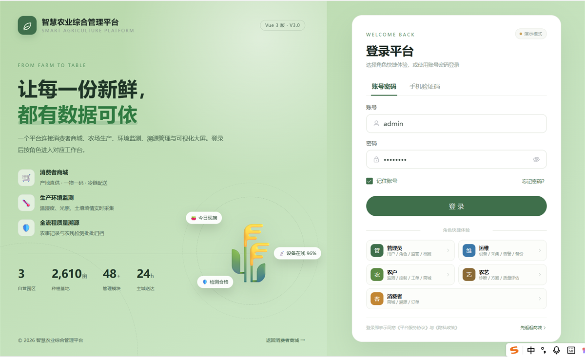
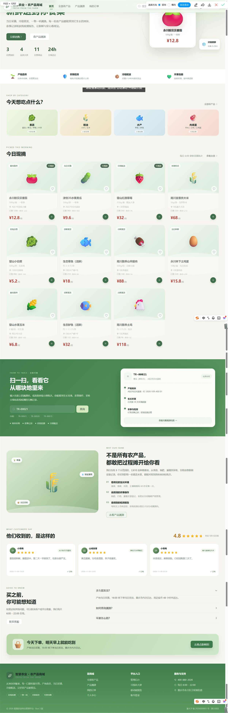
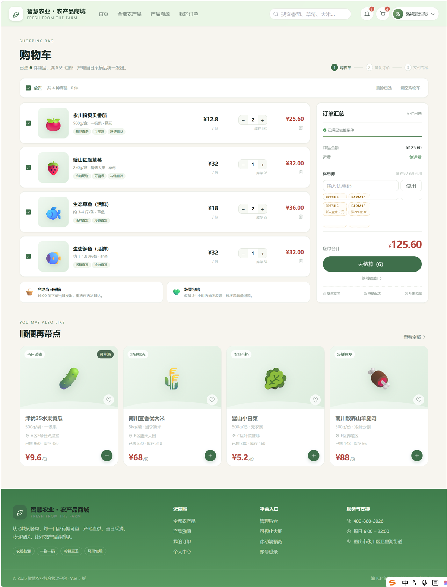
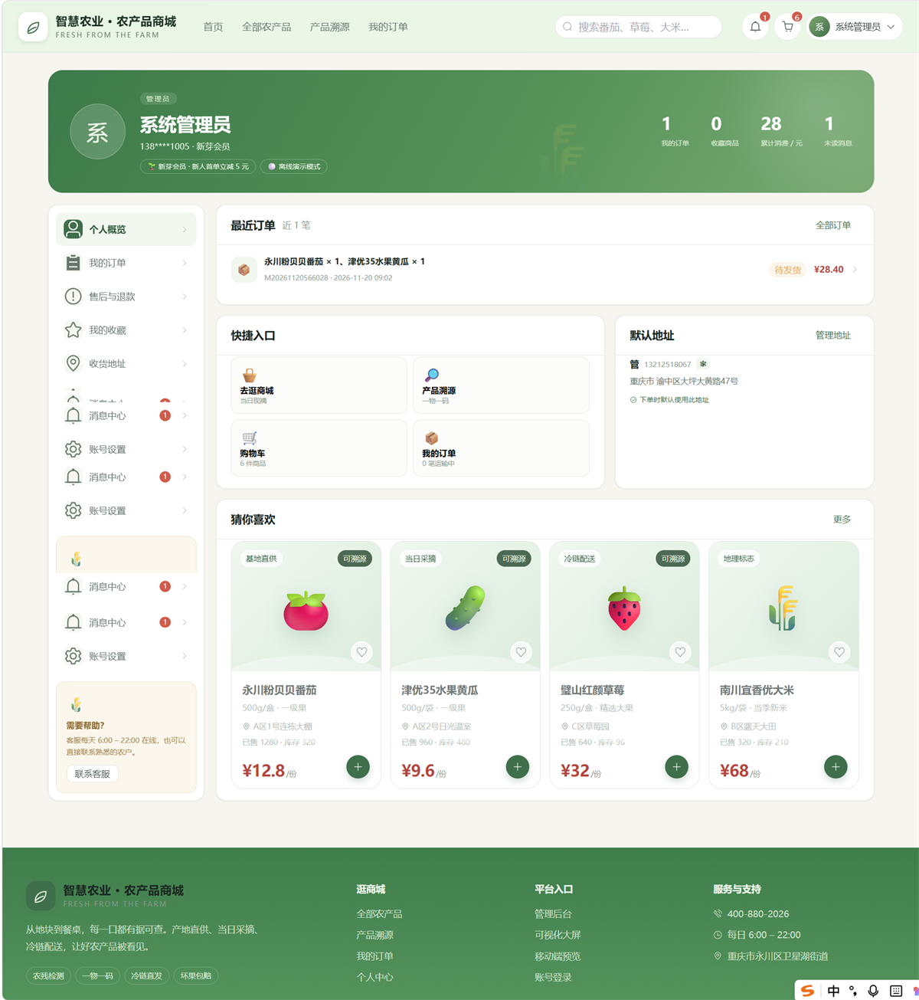
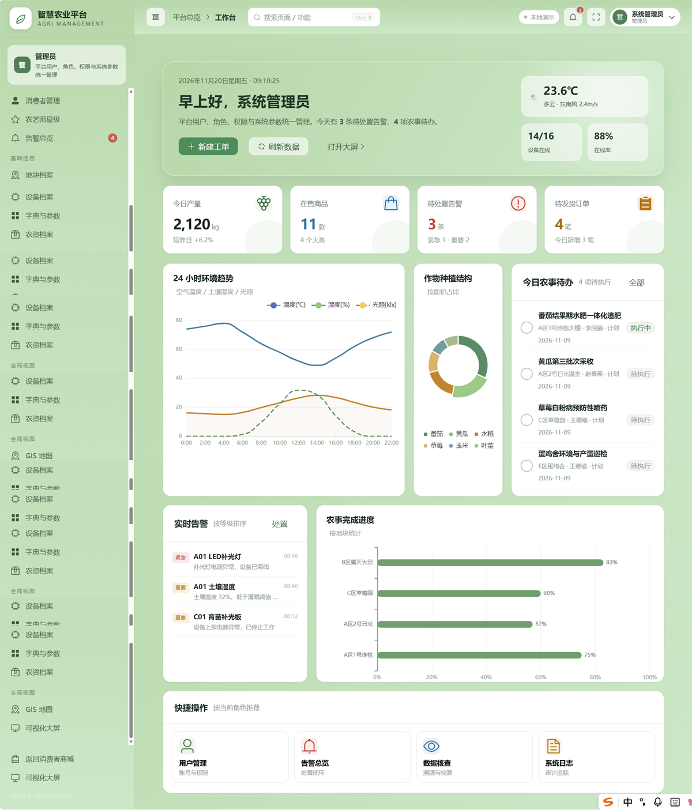
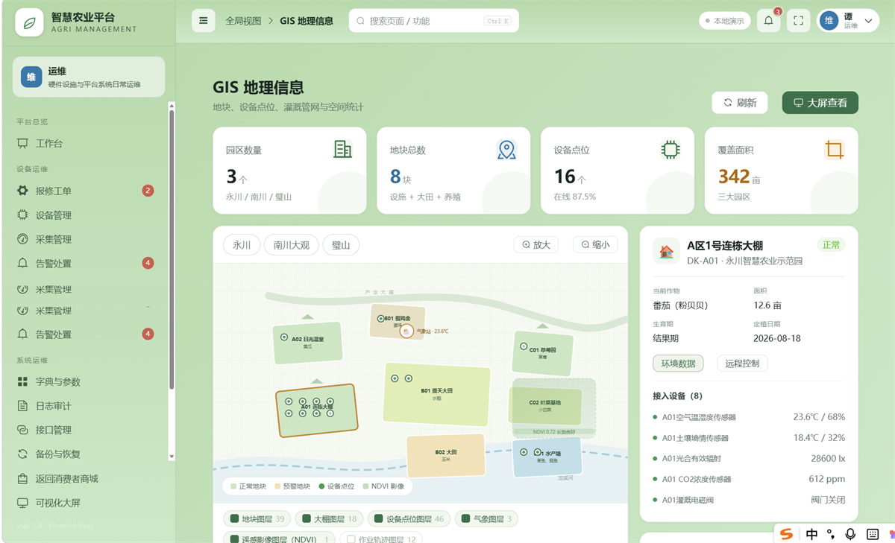
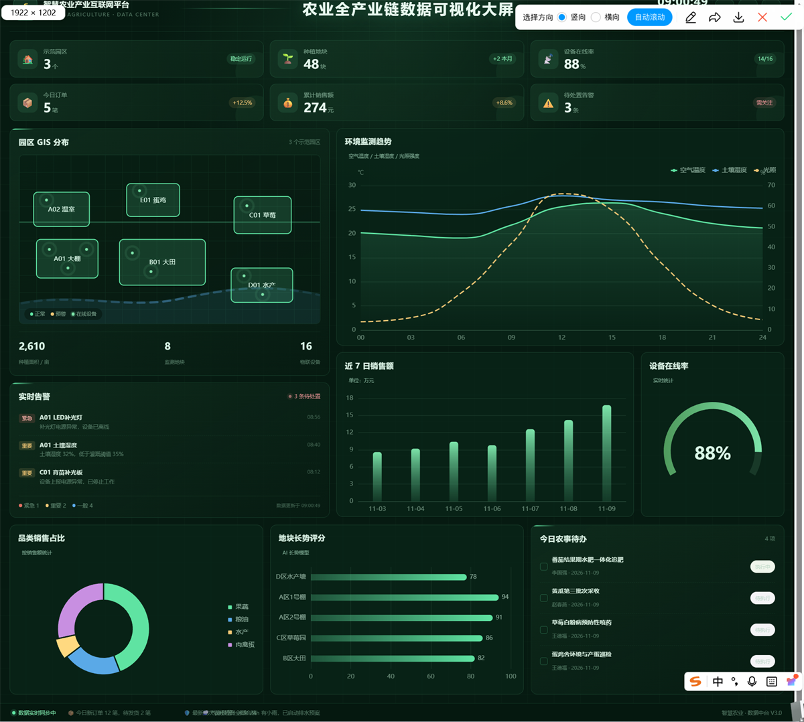
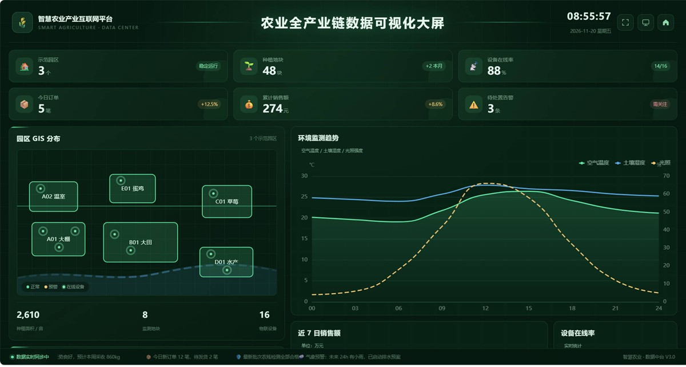

# 智慧农业综合管理平台

> 学校课程实践项目 · 团队协作开发
> 基于 Vue 3 的农业全链路管理平台前端，覆盖消费者商城、角色化运营后台、数据可视化大屏与移动端预览。

⚠️ 本项目为**教学演示用途**，数据均为虚拟演示数据，不接入真实生产环境，请勿用于商业用途。

---

## 一、项目简介

本项目围绕"从地块到餐桌"的农业业务场景，把消费者购买、农场生产、环境监测、质量溯源和运营管理放进同一套系统，并按角色区分工作台：

| 角色 | 关注内容 |
|---|---|
| 消费者 | 逛商城、下单、支付、评价、售后、看溯源 |
| 农户 | 地块、农事工单、采收、上架、订单发货、销售统计 |
| 农艺技术人员 | 长势监测、病虫害诊断、技术方案、农户咨询 |
| 运维人员 | 设备、采集、报修、告警处置、备份恢复 |
| 管理员 | 用户与权限、商品监管、系统参数、日志、数据监管 |

技术上采用前后端分离思路，本仓库目前为**前端实现**。为便于课程演示，业务数据由前端本地数据层（localStorage）驱动，无需部署数据库即可完整走通业务流程；后端服务正在开发中，完成后通过 `src/api/client.js` 接入联调。

---

## 二、功能模块

### 1. 消费者商城（`/mall`）

- 首页：品牌 Banner、品类导航、今日现摘、产地故事、买家评价、服务保障
- 全部农产品：关键词搜索、大类/小类两级筛选、价格与销量排序、收藏、加购
- 商品详情：多图切换、规格与库存、加入购物车、立即购买、详情 / 溯源 / 评价三个 Tab
- 产品溯源：溯源码查询、批次档案、检测报告、环境摘要、农事记录
- 购物车：全选、数量增减、删除、满额包邮进度、优惠券、金额汇总
- 确认订单：地址增删改、配送方式、支付方式、备注发票、提交订单
- 我的订单 / 订单详情：状态筛选、支付、提醒发货、确认收货、评价、物流时间线、申请售后
- 个人中心：消费概览、最近订单、收藏、地址簿、消息中心、账号设置

### 2. 运营后台（`/admin`）

后台菜单按登录角色动态生成，覆盖 40+ 业务页面，主要模块包括：

- 平台总览：核心指标、24 小时环境趋势、作物种植结构、农事完成进度、实时告警、今日待办、快捷操作
- 生产管理：地块档案、农事工单、农资管理、采收管理、产品上架
- 环境与设备：环境监测、视频监控、远程控制、设备管理、采集管理、设备报修
- 质量与溯源：农残检测、溯源档案、采收质量、检测报告
- 经营分析：订单管理、销售统计、用户评价、服务评价、报表中心
- 协同与服务：农户咨询（农艺师与农户双向会话）、病虫害诊断、技术方案
- 系统管理：用户、角色、权限、系统参数、操作日志、接口管理、数据监管、备份恢复
- GIS 园区地图：地块悬浮信息、设备点位、NDVI 扫描、作业轨迹

### 3. 可视化大屏（`/screen`）

深色数据大屏，包含园区 GIS 分布、环境趋势、品类占比、设备在线率、实时告警等模块，图表带入场动画与轮播高亮。

### 4. 移动端预览（`/mobile`）

手机框内展示消费者端核心流程，用于课程演示响应式与多端适配效果。

### 5. 界面截图

**登录 / 角色快捷体验**



**消费者商城首页**



**购物车与订单汇总**



**个人中心**



**运营后台工作台**



**GIS 园区地图**



**可视化大屏**





---

## 三、技术栈

| 分类 | 技术 |
|---|---|
| 框架 | Vue 3.5（Composition API + `<script setup>`） |
| 构建 | Vite 6 |
| 路由 | Vue Router 4 |
| 状态管理 | Pinia 2 |
| UI 组件 | Element Plus 2、@element-plus/icons-vue |
| 图表 | ECharts 5 |
| 样式 | 原生 CSS（CSS 变量主题、BEM 风格类名） |
| 数据层 | 浏览器 localStorage（模拟 REST 接口） |

---

## 四、快速开始

环境要求：Node.js 18+、npm 9+。

```bash
# 1. 克隆仓库
git clone <你的仓库地址>
cd platform-vue

# 2. 安装依赖
npm install

# 3. 启动开发服务器
npm run dev
```

打开 <http://127.0.0.1:5173>。

其他命令：

```bash
npm run build     # 生产构建，产物输出到 dist/
npm run preview   # 本地预览构建产物
```

---

## 五、演示账号

| 角色 | 账号 | 密码 |
|---|---|---|
| 管理员 | `admin` | `admin123` |
| 运维人员 | `ops01` | `ops123` |
| 农户 | `farmer01` | `farmer123` |
| 农艺技术人员 | `agri01` | `agri123` |
| 消费者 | 手机号 `18700002233` | 验证码 `8888` |

登录页提供"角色快捷体验"入口，也可以直接点击"先逛逛商城"以游客身份浏览。

---

## 六、主要页面入口

| 页面 | 地址 |
|---|---|
| 登录 / 角色选择 | `/login` |
| 消费者商城首页 | `/mall` |
| 全部农产品 | `/mall/products` |
| 商品详情 | `/mall/product/SP-001` |
| 产品溯源 | `/mall/trace` |
| 购物车 | `/mall/cart` |
| 确认订单 | `/mall/checkout` |
| 我的订单 | `/mall/orders` |
| 个人中心 | `/mall/profile` |
| 管理后台 | `/admin/dashboard` |
| 可视化大屏 | `/screen` |
| 移动端预览 | `/mobile` |

---

## 七、目录结构

```text
platform-vue/
├─ src/
│  ├─ api/client.js           # 请求封装（预留后端接口，当前默认走本地数据）
│  ├─ components/             # 通用组件：商品卡、图表容器、数据表、状态标签等
│  ├─ data/
│  │  ├─ db.js                # 演示数据：地块、设备、告警、商品、订单、溯源等
│  │  ├─ menus.js             # 角色菜单与演示账号
│  │  └─ adminPages.js        # 后台通用页配置
│  ├─ layouts/
│  │  ├─ MallLayout.vue       # 商城顶栏、搜索、消息、页脚
│  │  └─ AdminLayout.vue      # 后台侧边栏、顶栏、消息、全屏
│  ├─ router/index.js         # 路由、登录守卫、角色守卫
│  ├─ stores/                 # auth / cart / mall / admin
│  ├─ styles/base.css         # 主题变量与基础样式
│  ├─ views/
│  │  ├─ mall/                # 商城 9 个页面
│  │  ├─ admin/               # 后台自定义页面
│  │  ├─ Login.vue
│  │  ├─ Screen.vue           # 可视化大屏
│  │  ├─ Mobile.vue           # 移动端预览
│  │  └─ NotFound.vue
│  ├─ App.vue
│  └─ main.js
├─ vite.config.js             # 别名与代理配置
├─ package.json
└─ README.md
```

---

## 八、数据说明

- 所有演示数据位于 `src/data/db.js`，首次进入会写入浏览器 `localStorage`。
- 订单、消息、收藏、地址、售后、评价等消费者数据按**账号独立存储**，不同账号之间互不可见。
- 清除演示数据：打开浏览器开发者工具 → Application → Local Storage，删除以 `agri_vue_` 开头的键，刷新页面即可恢复初始状态。
- 本项目当前**不包含后端服务代码**（后端正在开发中），`src/api/client.js` 中已保留 REST 接口调用约定，便于后续接入真实服务。

---

## 九、团队分工

| 成员 | 负责方向 | 主要模块与页面 |
|---|---|---|
| 谭同学 | 工程基建、数据层、可视化大屏 | 路由与角色守卫、Pinia 状态、全局主题与布局、通用组件、`src/data/db.js`；可视化大屏（`Screen.vue`）、GIS 园区地图、运营工作台、登录页 |
| 朱同学 | 消费者商城全链路 | 商城布局与 9 个页面：首页、全部农产品、商品详情、购物车、确认订单、我的订单、订单详情、个人中心、产品溯源；购物车与商城状态 |
| 张同学 | 设备运维与环境感知 | 环境监测、设备管理、采集管理、远程控制、视频监控、告警中心、报修工单、农资管理、农事工单、溯源录入、订单管理 |
| 龙同学 | 数据报表与农艺技术 | 数据中心与统计报表、销售统计、AI 智能分析、环境与长势、病虫害诊断、在线咨询、移动端预览 |
| 王同学 | 系统管理与权限 | 用户、角色、权限、系统参数、备份恢复、消费者管理、商品监管、日志审计、接口管理 |
| 吴同学 | 基础档案与监管核查 | 地块档案、设备档案、字典与参数、农资档案、数据监管核查、农残报告核查、农艺师星级、采收质量评估、农残报告查看 |

说明：

- 后台大量档案/监管类页面由 `src/data/adminPages.js` 的配置驱动（统计卡 + 筛选 + 表格 + 详情弹窗），负责成员主要维护对应配置与字段规则。
- `src/data/db.js` 为全站唯一演示数据源，统一由谭同学维护，其他成员按需提出数据需求，避免多人同时修改产生冲突。
- 本项目由以上成员共同完成，需求分析、界面设计、前端开发、数据整理与测试均由团队协作推进。

后端服务目前仍在开发中，完成后将与前端进行接口联调；当前版本以本地演示数据驱动，保证在无后端环境下也能完整展示业务流程。后端按同一模块边界划分：鉴权与网关、商品订单、设备告警、统计与咨询、用户权限、档案溯源。

---

## 十、开发说明与已知限制

- 本项目为课程实践作品，目前以前端业务建模与交互实现为主，后端服务正在开发中，暂未接入真实支付、物流、短信和硬件设备。
- 环境监测、设备状态、告警等数据为模拟数据，定时器驱动变化，仅用于展示。
- 未包含单元测试与端到端测试。
- 生产构建体积较大（ECharts 全量引入），如需优化可改为按需引入。

---

## 十一、致谢

感谢指导老师在本项目选题、业务梳理与评审过程中给予的指导，也感谢 Element Plus、ECharts、Vite 等开源社区提供的优秀工具。

本项目仅用于学习交流，如涉及第三方素材版权问题，请联系团队成员处理。
